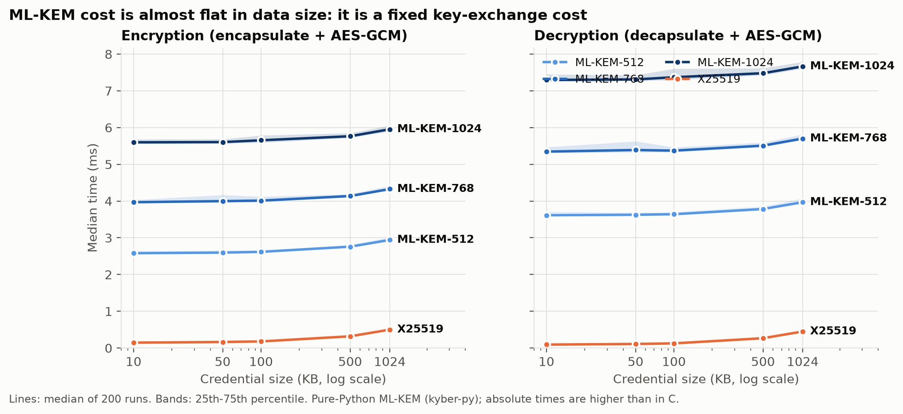
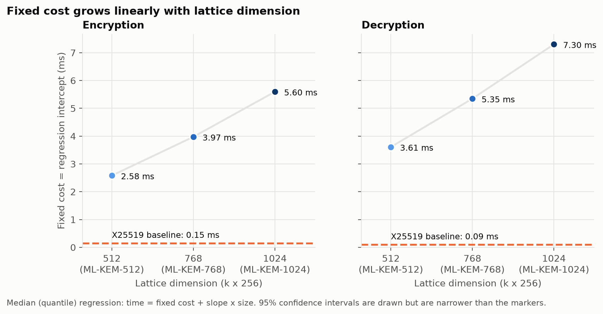
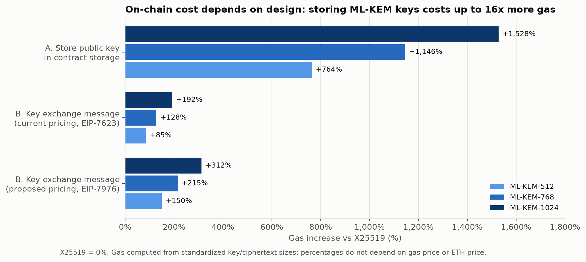
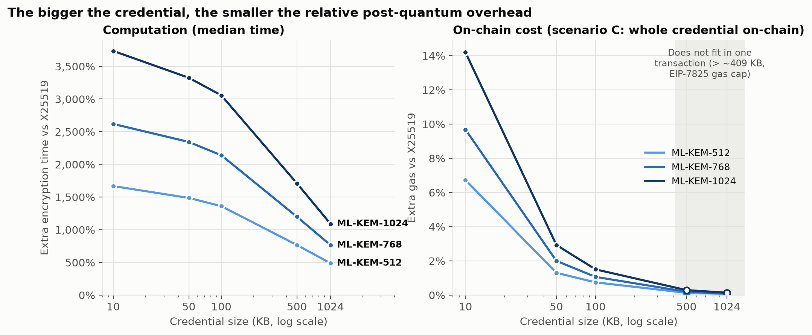

# Post-Quantum Key Encapsulation for Decentralized Identity: Computational Overhead and Ethereum Gas Cost of ML-KEM

How much does it cost to make a decentralized identity (DID) system quantum-safe? This project measures the computational overhead of **ML-KEM** (FIPS 203, the NIST post-quantum key-encapsulation standard) for encrypting identity credentials of 10 KB to 1 MB, and models how its larger keys change **Ethereum gas costs** in three realistic DID designs. The classical baseline is **X25519**.

## Key findings

1. **The post-quantum overhead is a fixed cost.** ML-KEM adds 2.4-5.5 ms per encryption (pure-Python implementation), regardless of credential size. The per-megabyte cost of encrypting the credential itself is identical for all schemes (~0.36 ms/MB, AES-256-GCM).
2. **The fixed cost grows linearly with lattice dimension:** about +1.5 ms (encryption) and +1.8 ms (decryption) per +256 dimensions.
3. **On-chain cost depends on design, not on the algorithm alone.** Replacing X25519 with ML-KEM raises gas by +85% to +192% when only the key-exchange message goes on-chain, but by **+764% to +1,528%** when the public key is stored in contract storage. The answer to "how much more will fees be?" ranges from about 1% to over 1,500%.

## Research questions

- **RQ1.** How does ML-KEM's encryption/decryption time scale with credential size, compared with X25519?
- **RQ2.** How does the overhead change across the three ML-KEM parameter sets (lattice dimension 512 / 768 / 1024)?
- **RQ3.** By what percentage would Ethereum transaction fees rise if a DID system switched from X25519 to ML-KEM?

## Method

### 1. Hybrid encryption (KEM-DEM)

ML-KEM is a key-encapsulation mechanism: it establishes a 32-byte shared secret and does not encrypt data directly. Credentials are therefore encrypted with the standard KEM-DEM construction:

| Step | Post-quantum | Classical baseline |
|---|---|---|
| Key exchange | ML-KEM-512 / 768 / 1024 (`kyber-py`) | X25519 + HKDF-SHA256 (`cryptography`) |
| Data encryption | AES-256-GCM (`pycryptodome`) | AES-256-GCM (`pycryptodome`) |

Every round trip is checked for correctness: the decrypted credential must equal the original (`src/hybrid.py`, `src/test_hybrid.py`).

### 2. Benchmark design (`src/benchmark.py`)

- **Design:** 4 schemes x 5 credential sizes (10, 50, 100, 500, 1024 KB) x 200 repetitions = **4,000 measurements**.
- **Phases timed separately** with `time.perf_counter_ns()`: key generation, encapsulation, AES encryption, decapsulation, AES decryption.
- **Randomized run order** (fixed seed 42) and 20 warm-up rounds. A first version measured each condition in one consecutive block. Background activity on the laptop then contaminated whole blocks, producing medians that *decreased* with data size. Randomizing the order spread the noise evenly across conditions and removed the artifact.

### 3. Statistical analysis (`src/analysis.py`)

- **Outlier check first.** 0.5-1.1% of runs were more than 3x slower than their group median (worst: 116 ms vs. a 5.6 ms median), caused by OS interruptions.
- **Median (quantile) regression** per scheme: `time = fixed cost + slope x size`. Ordinary least squares (OLS) is reported for comparison only: the rare spikes pulled its estimates around and even produced a *negative* slope for one scheme.
- **Slope equality test:** an interaction model (`time ~ size x scheme`) tests whether the per-MB cost differs between schemes.
- **Lattice dimension trend:** fixed cost regressed on dimension (3 points, descriptive only).

### 4. Gas model (`src/gas_model.py`)

Ethereum charges gas for **bytes and storage, not CPU time**, so gas is computed from the standardized key and ciphertext sizes using the protocol's pricing formula rather than regressed from timings.

| | X25519 | ML-KEM-512 | ML-KEM-768 | ML-KEM-1024 |
|---|---|---|---|---|
| Public key (bytes) | 32 | 800 | 1,184 | 1,568 |
| Ciphertext / ephemeral key (bytes) | 32 | 768 | 1,088 | 1,568 |

- **Pricing rules:** *current* = EIP-7623 (calldata 4/16 gas per zero/non-zero byte, floor 10/40); *proposed* = EIP-7976 (floor 64/64, planned for the Glamsterdam upgrade). Per-transaction gas cap of 16,777,216 (EIP-7825). New storage slot = 22,100 gas (20,000 + 2,100 cold access, EIP-2929).
- **DID scenarios:**
  - **A. Register key:** the holder's public key is stored in a DID registry contract.
  - **B. Key exchange:** the KEM ciphertext, nonce/tag and a 34-byte IPFS pointer are posted as an event; the encrypted credential stays off-chain.
  - **C. Full on-chain:** the whole encrypted credential is posted on-chain (naive design, for comparison).

## Results

### RQ1: ML-KEM cost is almost flat in credential size



Median regression estimates (encryption):

| Scheme | Fixed cost (ms) [95% CI] | Slope (ms/MB) | Fixed cost vs X25519 |
|---|---|---|---|
| ML-KEM-512 | 2.581 [2.577, 2.585] | 0.362 | 17.8x |
| ML-KEM-768 | 3.974 [3.968, 3.981] | 0.350 | 27.4x |
| ML-KEM-1024 | 5.596 [5.586, 5.605] | 0.358 | 38.6x |
| X25519 | 0.145 [0.143, 0.147] | 0.356 | 1x |

The slopes are practically identical, as expected, because every scheme encrypts the data with the same AES-GCM. The interaction test gave p = 0.21 for encryption and p = 0.048 for decryption. The decryption result is "significant" only because 4,000 samples can detect a slope difference of **0.01 ms/MB**, about 1/500 of the fixed-cost difference. Statistically detectable, practically irrelevant.

The low R² of the per-scheme fits (< 0.05 for ML-KEM) is itself evidence for the main claim: credential size explains almost none of ML-KEM's cost. For ML-KEM-768, the key exchange costs as much as AES-encrypting roughly 11 MB of data, so for typical credentials (tens to hundreds of KB) the key exchange dominates.

### RQ2: Fixed cost grows linearly with lattice dimension



Each +256 dimensions (one more module rank, k) adds about **1.5 ms to encryption and 1.8 ms to decryption**. Decapsulation costs more than encapsulation because FIPS 203 decapsulation re-encrypts the message to check the ciphertext (the Fujisaki-Okamoto transform).

### RQ3: Gas increase depends on the DID design



| Scenario | ML-KEM-512 | ML-KEM-768 | ML-KEM-1024 |
|---|---|---|---|
| A. Store public key (current or proposed pricing) | +764% | +1,146% | +1,528% |
| B. Key exchange message, current pricing (EIP-7623) | +85% | +128% | +192% |
| B. Key exchange message, proposed pricing (EIP-7976) | +150% | +215% | +312% |

- **Scenario A is storage-dominated.** An ML-KEM-768 key needs 38 storage slots versus 2 for X25519. Because storage, not calldata, drives the cost, calldata repricing barely changes the result.
- **Scenario B becomes more expensive under proposed pricing**: the gap grows from +128% to +215% for ML-KEM-768.

### Relative overhead shrinks as credentials grow



In scenario C, the extra gas falls from +6.7-14% at 10 KB to +0.75-1.5% at 100 KB. However, any credential above roughly 409 KB no longer fits in a single transaction, for every scheme, so storing credentials fully on-chain is not a viable design regardless of the cryptography.

## Discussion

- **Design matters more than the algorithm.** The most effective way to limit the gas cost of post-quantum DID is architectural: keep the ML-KEM public key off-chain (e.g. in a DID document on IPFS) and store only its 32-byte hash on-chain. The on-chain footprint would then be the same as for X25519.
- **The computational overhead is acceptable for identity workflows.** Even in pure Python, ML-KEM-1024 adds under 8 ms per operation. Optimized C implementations are expected to be one to two orders of magnitude faster.
- **Methodological lessons.** Two early results were artifacts of the analysis, not properties of ML-KEM: non-monotonic medians from blocked run order, and a negative slope from OLS on heavy-tailed timing data. Randomization and median regression fixed both. "Not significant" did not mean "equal", and "significant" did not mean "important"; effect sizes were reported alongside every test.

## Limitations

**Gas model**

- **Execution overhead is an assumption.** Each contract call is charged a fixed 5,000 gas for function dispatch, ABI decoding and checks (`CALL_OVERHEAD` in `src/gas_model.py`). This figure is an estimate, not a measurement from a deployed contract. The goal is a fair comparison between X25519 and ML-KEM rather than an exact audit of a specific contract.
- **USD figures are illustrative only.** The dollar costs assume a gas price of 1 gwei and an ETH price of $3,000 (`GAS_PRICE_GWEI` and `ETH_USD` at the bottom of `src/gas_model.py`). Both values change constantly and should be updated before quoting any dollar amount.
- **Percentage increases do not depend on market prices.** The main result, the gas increase of ML-KEM relative to X25519, is a ratio of gas units. Gas price and ETH price cancel out, so the percentages hold regardless of market conditions.
- **Gas is calculated, not regressed.** The original plan was to predict gas fees with a statistical regression. However, Ethereum gas is determined exactly by a published formula (calldata bytes, storage slots and execution cost), not by CPU time. Gas is therefore computed directly from the standardized key and ciphertext sizes. Statistical modelling is applied where it belongs: to the timing measurements, which contain real measurement noise.
- **Proposed pricing rules may change.** The "proposed" scenario uses EIP-7976 (64/64 gas per calldata byte), which is planned for the Glamsterdam upgrade but is not yet live. Its final parameters, and other proposed repricings (e.g. storage costs), may differ from what is modelled here.

**Timing benchmark**

- **Pure-Python implementation.** ML-KEM timings come from `kyber-py`, a pure-Python reference implementation that is not optimized for speed. Absolute timings, and the ML-KEM vs X25519 ratio, are much larger than they would be with an optimized C implementation such as liboqs. The structural finding (a fixed key-encapsulation cost plus an identical per-MB AES cost) is expected to hold, but the absolute numbers should not be generalized.
- **Single machine.** All timings were measured on one laptop (macOS, Apple Silicon). Results on other hardware will differ in absolute terms.

## Reproduce

```bash
python -m venv venv && source venv/bin/activate
pip install -r requirements.txt
cd src
python test_hybrid.py   # correctness check
python benchmark.py     # ~1 min -> data/results.csv
python analysis.py      # -> data/regression_summary.csv
python gas_model.py     # -> data/gas_results.csv
python plots.py         # -> figures/*.png
```

Timing results will differ on other hardware; gas results are deterministic and will match exactly.

## Repository structure

```
src/
  hybrid.py        KEM-DEM hybrid encryption (ML-KEM / X25519 + AES-256-GCM)
  test_hybrid.py   round-trip correctness test
  benchmark.py     randomized timing experiment
  analysis.py      outlier check, median regression, hypothesis tests
  gas_model.py     Ethereum gas model for three DID scenarios
  plots.py         figures
data/              raw measurements and model outputs (CSV)
figures/           figures used in this README
```

## Future work

- Re-run the benchmark with an optimized C implementation (liboqs) and compare with the pure-Python results.
- Add a "hash commitment" scenario (only a 32-byte key hash on-chain) to quantify the design recommendation.
- Extend the gas model to layer-2 rollups and to post-quantum signatures (ML-DSA), which DID systems also need.

## References

- NIST, *FIPS 203: Module-Lattice-Based Key-Encapsulation Mechanism Standard*, 2024. https://csrc.nist.gov/pubs/fips/203/final
- EIP-7623: Increase calldata cost. https://eips.ethereum.org/EIPS/eip-7623
- EIP-7976: Increase calldata floor cost. https://eips.ethereum.org/EIPS/eip-7976
- EIP-7825: Transaction gas limit cap. https://eips.ethereum.org/EIPS/eip-7825
- EIP-2929: Gas cost increases for state access opcodes. https://eips.ethereum.org/EIPS/eip-2929
- G. Pope, *kyber-py*: pure-Python ML-KEM. https://github.com/GiacomoPope/kyber-py
